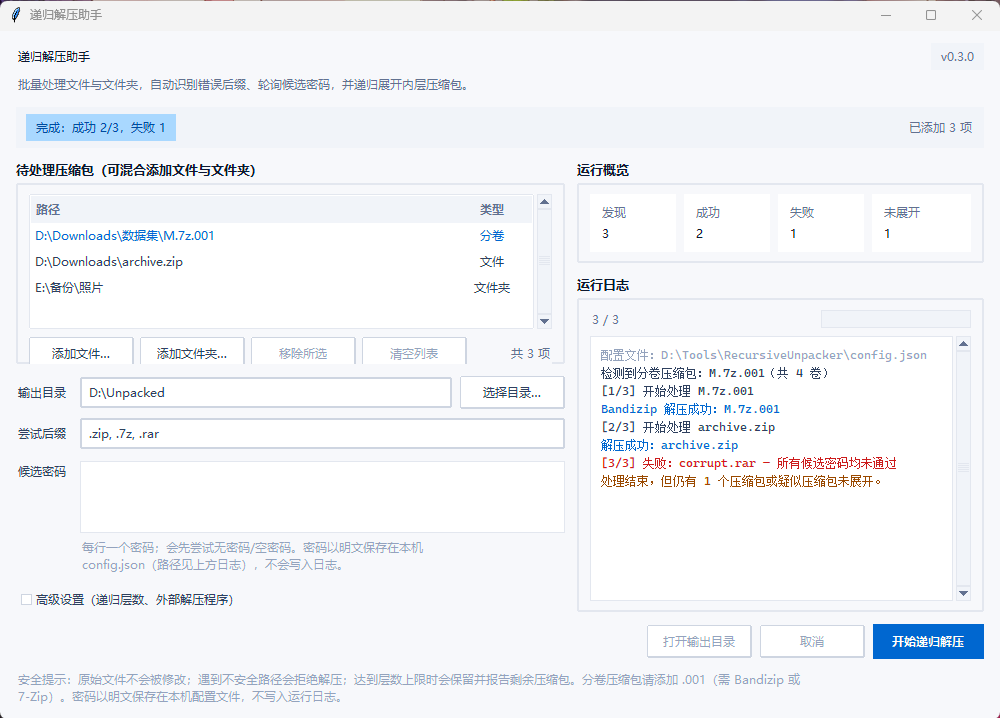

<div align="center">

# 递归解压助手 · Recursive Unpacker

**Windows 友好的 Python GUI 工具：按文件头识别压缩格式、轮询候选密码，批量递归展开内层压缩包。**

[](LICENSE)
[](https://www.python.org/)
[](#环境要求)
[](recursive_unpacker/__init__.py)

</div>

一个“添加文件/文件夹 → 填后缀候选与密码 → 一键批量递归展开”的桌面小工具。它不依赖扩展名判断格式，而是读取文件头；找不到正确后缀或密码时不会假装成功，会明确告诉你哪些压缩包没被解开。

<div align="center">



</div>

---

## 目录

- [核心特性](#核心特性)
- [技术栈](#技术栈)
- [环境要求](#环境要求)
- [安装](#安装)
- [快速上手](#快速上手)
- [命令行 / API 用法](#命令行--api-用法)
- [目录结构](#目录结构)
- [FAQ](#faq)
- [贡献指南](#贡献指南)
- [许可证](#许可证)

---

## 核心特性

- **左右工作台界面**：左栏是输入（待处理列表、输出目录、后缀、密码、高级设置），右栏是运行遥测（概览指标 + 运行日志）。待处理列表以表格呈现并标注「文件 / 文件夹 / 分卷」，分卷行标蓝、路径失效标红；日志按结果着色（成功蓝、失败红、警告琥珀）。基于 `ttk` 的 `clam` 主题统一配色，零额外依赖；窗口高度按内容自适应，1080p 屏幕下不会超出。
- **按文件头识别格式**：通过魔数（magic signature）识别 `ZIP`、`7z`、`RAR`、`TAR`、`GZIP`、`BZIP2`、`XZ`，不轻信文件后缀。
- **支持分卷压缩包**：自动识别 `M.7z.001` / `M.zip.001` 这类多卷集合，**以原始路径**交给 Bandizip / 7-Zip 解压（复制或改名单个分卷会切断卷链）。只把 `.001` 作为入口，`.002` 及以后不会被重复排队；缺卷时会明确报告缺哪一卷；勾选「删除内层压缩包」时分卷会被整组删除，不会只删掉 `.001` 留下残片。
- **多后端解压**：优先调用 [Bandizip](https://www.bandisoft.com/bandizip/) 的 `bz.exe`；不可用时回退到 7-Zip（`7z.exe`），再回退到纯 Python 后端（`zipfile`/`pyzipper`、`py7zr`、`tarfile`、`gzip`/`bz2`/`lzma`）。
- **候选密码轮询**：先尝试无密码/空密码，再按顺序尝试你提供的候选密码。密码会以**明文**保存在本机 `config.json`（不在日志中出现），详见 [FAQ Q2](#faq)。
- **批量处理**：可在同一个列表里混合添加多个压缩包与多个文件夹；文件夹可勾选“包含子文件夹”以递归扫描。每个包解压到独立子目录，**单个包失败不会中断整批**，结束后给出成功/失败清单。
- **设置持久化**：输出目录、后缀候选、递归层数、Bandizip/7-Zip 路径、各开关与候选密码都会记住，下次启动自动回填。
- **递归展开**：自动识别并继续解压内层压缩包，默认最大深度 `5`（可设 `1–20`）。
- **安全校验（内置）**：
  - 拒绝路径穿越（`../`、绝对路径、盘符）与符号链接/特殊文件；
  - 对 ZIP/TAR 解压前预估体积，并对解压结果做文件数/体积复查（上限 100,000 文件 / 20 GiB）；
  - 原始输入文件**永不修改、永不删除**。
- **可视化解压过程**：后台线程执行、实时日志、可随时取消。
- **可打包为 EXE**：运行 `build_exe.bat` 产出**单文件** `dist\RecursiveUnpacker.exe`（onefile + 窗口模式 + Windows 版本资源），脱离 Python 环境分发。`RecursiveUnpacker.spec` 是该脚本生成的中间产物，不要手工编辑。配置写在 exe 同目录，**分发时不要把带密码的 `config.json` 一起发出去**。

---

## 技术栈

| 类别 | 技术 |
| --- | --- |
| 语言 | Python 3.11+ |
| GUI | Tkinter（Python 标准库自带）+ `ttk`，配色基于 `clam` 主题 |
| 解压后端 | Bandizip `bz.exe`、7-Zip `7z.exe`、`zipfile`/`pyzipper`、`py7zr`、`tarfile` |
| 测试 | pytest |
| 打包 | PyInstaller（可选） |

---

## 环境要求

- **操作系统**：Windows（GUI 面向 Windows；核心解压逻辑为纯 Python，可在其他平台运行）。
- **Python**：3.11 或更高，且包含 Tcl/Tk（Windows 官方安装包默认包含）。
- **可选外部程序**：
  - [Bandizip](https://www.bandisoft.com/bandizip/)（推荐，提供 `bz.exe`，用于 RAR 及常见格式，并支持解压前校验成员路径）；
  - [7-Zip](https://www.7-zip.org/)（可选回退，提供 `7z.exe`）。

---

## 安装

```bash
git clone https://github.com/yucode-kk/recursive-unpacker.git
cd recursive-unpacker
pip install -r requirements.txt
```

`requirements.txt` 只包含两个**可选**依赖（普通 ZIP 无需它们也能工作）：

- `py7zr`：直接以 Python 处理 7z；
- `pyzipper`：支持 AES 加密的 ZIP。

> 提示：在 Windows 上也可以直接双击 `run.bat`，首次运行会自动安装上述可选依赖。

---

## 快速上手

### 图形界面

启动后窗口分为左右两栏：**左栏是输入**（待处理列表、输出目录、后缀、密码、高级设置），**右栏是运行遥测**（概览指标与运行日志）。

1. 双击 `run.bat`（或执行 `python main.py`）启动。
2. 左栏「待处理压缩包」里用 **添加文件…**（支持多选）或 **添加文件夹…** 加入待处理项；可混合添加多个来源，重复项会自动忽略。表格的「类型」列会标出 文件 / 文件夹 / 分卷。
3. 选择 **输出目录**。每个压缩包会解压到该目录下以源文件名命名的子目录。
4. 在 **尝试后缀** 中填写候选后缀，例如 `.zip, .7z, .rar`。
5. 在 **候选密码** 中每行填一个可能的密码（可为空）。密码会保存到本机 `config.json`，下次启动自动回填。
6. 勾选左栏底部的 **高级设置** 展开递归层数、包含子文件夹、内层包删除开关与 Bandizip / 7-Zip 路径——该面板默认折叠，主界面只留高频项。其中「包含子文件夹」勾选时文件夹递归扫描，未勾选只处理直属压缩包。
7. 点击 **开始递归解压**。运行中右栏「运行概览」实时更新 发现 / 成功 / 失败 / 未展开 四个数字，进度条与日志同步刷新。
8. 完成后点击 **打开输出目录**。

### 命令行 / API 用法

核心逻辑可直接以 Python API 调用：

```python
from recursive_unpacker.core import extract_recursive

report = extract_recursive(
    "bundle.zip",                     # 输入文件
    "output",                         # 输出根目录
    extensions=[".zip", ".7z", ".rar"],
    passwords=["password1", "password2"],
    max_depth=5,
    delete_nested=True,
)

print(f"已解压 {report.extracted_archives} 个压缩包")
print(f"输出目录：{report.output_dir}")
print(f"仍未展开：{report.remaining_archives}")
print(f"警告：{report.warnings}")
```

`extract_recursive` 返回一个 `ExtractionReport`，包含 `output_dir`、`extracted_archives`、`remaining_archives` 与 `warnings`。达到递归上限或某个压缩包无法展开时，会将其保留在 `remaining_archives` 并明确报告，而不会假装全部完成。

批量场景可组合 `discover_archives` 与 `extract_batch`：

```python
from recursive_unpacker.batch import discover_archives, extract_batch

archives = discover_archives(
    ["D:/downloads", "E:/backup/pack.zip"],   # 可混合文件夹与文件
    [".zip", ".7z", ".rar"],
    recursive=True,                           # 等价于界面的「包含子文件夹」
)

result = extract_batch(archives, "output", passwords=["password1"], max_depth=5)
print(f"成功 {len(result.succeeded)} / 失败 {len(result.failed)}")
for item in result.failed:
    print(item.source.name, item.error)
```

`extract_batch` 中单个包失败不会抛异常，而是记录在 `result.failed` 里；只有用户取消时才抛出 `ExtractionCancelled`，并把已完成部分挂在 `exc.report` 上。

> `ExtractionReport.used_password` 记录本次实际生效的密码，仅用于批内优化（把该密码提前到后续任务的首选位置），**不要打印它，也不要写入日志**。

---

## 目录结构

```
recursive-unpacker/
├── main.py                     # 应用入口
├── recursive_unpacker/
│   ├── __init__.py             # 版本号
│   ├── core.py                 # 格式识别、安全校验、多后端解压、单包递归逻辑
│   ├── volumes.py              # 分卷压缩包识别（.7z.001 等）与整组删除
│   ├── batch.py                # 多源发现、批量编排、会话内密码提升
│   ├── config.py               # 本机设置文件：路径解析、容错读取、原子写入
│   ├── theme.py                # 配色、字体与 ttk 样式（clam 主题）
│   ├── panels.py               # 左右工作台各分区的控件构建
│   └── gui.py                  # Tkinter 图形界面（事件、线程与流程）
├── tests/
│   ├── conftest.py             # 公共 fixture（内存造包、屏蔽外部后端、临时配置）
│   ├── test_core.py            # 核心解压与安全校验测试
│   ├── test_volumes.py         # 分卷识别与缺卷检测测试
│   ├── test_batch.py           # 批量发现与编排测试
│   ├── test_config.py          # 设置文件读写与容错测试
│   ├── test_theme.py           # 样式映射与日志着色规则测试
│   ├── test_gui.py             # 界面纯函数、列表类型列与密码回填测试
│   └── test_version.py         # 校验 version_info.txt 与 __version__ 一致
├── docs/
│   └── screenshots/workbench.png  # README 界面预览
├── config.json                 # 本机生成，含明文密码，已被 .gitignore 排除
├── version_info.txt            # Windows 版本资源（单表达式，PyInstaller 用 eval 加载）
├── requirements.txt            # 可选运行时依赖
├── requirements-dev.txt        # 开发/测试依赖
├── run.bat                     # Windows 一键启动（源码运行）
├── build_exe.bat               # PyInstaller 打包脚本（产出单文件 exe）
├── RecursiveUnpacker.spec      # 由 build_exe.bat 生成，请勿手工编辑
├── AGENTS.md                   # 面向 AI 代理与协作者的硬性约束
├── LICENSE                     # MIT 许可证
└── README.md
```

---

## FAQ

**Q1：为什么某些压缩包没有被解开？**
通常是以下两种原因之一：达到了最大递归深度，或该格式在当前后端不可用（例如 RAR 需要安装 Bandizip 或 7-Zip）。程序会把这些压缩包保留并列出，而不是静默跳过。

**Q2：我的密码会被保存或泄露吗？**
**会被保存，且是明文。** 程序把你填写的候选密码写入本机 `config.json`，下次启动自动回填，因此你不需要重复输入。该文件已加入 `.gitignore`，不会被提交到仓库；密码不会出现在运行日志、异常消息或结果对话框中。

保存位置按以下顺序确定：

1. 程序目录（源码运行 = 项目根目录；EXE 运行 = `EXE` 所在目录）；
2. 若程序目录不可写（例如放在 `C:\Program Files\`），自动回退到 `%APPDATA%\RecursiveUnpacker\config.json`，并在日志中提示。

想清空已保存的密码：删除密码框中的内容后点一次“开始递归解压”，或直接关闭窗口即可写入空列表；也可以手动删除 `config.json`。另外，使用外部 Bandizip / 7-Zip 处理加密归档时，密码会作为命令行参数传入该子进程，在共享设备上请注意本机其他用户的进程可见性。

**Q3：这是密码破解工具吗？**
不是。它只会按顺序尝试你提供的候选密码，不会进行任何暴力破解。

**Q4：支持 macOS / Linux 吗？**
核心解压逻辑（`core.py`）是跨平台的，可直接在任意平台以 API 方式调用；GUI 使用 Tkinter，理论上可跨平台运行，但 `bz.exe` / `7z.exe` 的自动路径查找主要面向 Windows。

**Q5：解压会不会损坏我的原始文件？**
不会。原始输入文件始终保留，结果写入输出目录下以源文件名命名的子文件夹；同名目录已存在时会自动生成新名称。

**Q6：为什么文件夹里有些压缩包没被处理？**
两个常见原因：一是「包含子文件夹」未勾选，此时只扫描该文件夹的直属文件；二是文件后缀不在「尝试后缀」列表内。注意区分：**手动添加的单个文件不受后缀限制**（会用文件头识别，因此 `bundle.bin` 这类错后缀文件仍能解压），只有文件夹扫描的结果按后缀过滤。另外，输出目录内部的文件会被自动跳过，避免把上一轮产物再解压一遍。

**Q7：批量处理时某个包失败会怎样？**
该包被记为失败，其余包继续处理，整批不会中断。结束后对话框会列出失败清单（最多 10 条，其余详见运行日志）；你也可以在运行中随时点击“取消”，已完成的输出会保留。

**Q8：`M.7z.001` 这种分卷压缩包能解吗？**
能，前提是**所有分卷放在同一文件夹且编号连续**。添加时选 `.001` 即可；添加整个文件夹也行，程序只会把 `.001` 当作入口，`.002` 及以后不会被重复排队。

分卷**只能**交给 Bandizip 或 7-Zip 处理——纯 Python 后端（`py7zr`）不支持分卷。因此未配置外部程序时，程序会直接提示需要 `bz.exe`／`7z.exe`，而不是给出含糊的失败信息。缺卷时错误信息会具体指出缺哪一卷，例如「缺少分卷 .002」。另外，勾选「内层压缩包成功解压后删除原压缩包」时分卷会被**整组删除**，不会只删掉 `.001` 而留下无法再用的残片。

---

## 贡献指南

欢迎提交 Issue 与 Pull Request。请遵循以下约定：

1. 理解项目的全局约束：**永不修改原始文件、永不把密码写入日志或异常消息、拒绝不安全路径、未完全展开时必须如实报告**。密码仅可按用户知情以明文保存在已被 `.gitignore` 排除的本机 `config.json` 中；新增含凭据的生成文件前，请先补 `.gitignore`。
2. 提交信息遵循 [Conventional Commits](https://www.conventionalcommits.org/)（如 `feat:`、`fix:`、`test:`、`docs:`）。
3. 修改后运行测试：

```bash
pip install -r requirements-dev.txt
pytest -q
python -m compileall -q main.py recursive_unpacker tests
```

4. 保持代码小步、可测试；涉及解压/安全逻辑的改动请补充对应测试用例。

---

## 许可证

本项目采用 [MIT License](LICENSE) 开源。Copyright © 2026 Recursive Unpacker contributors。
